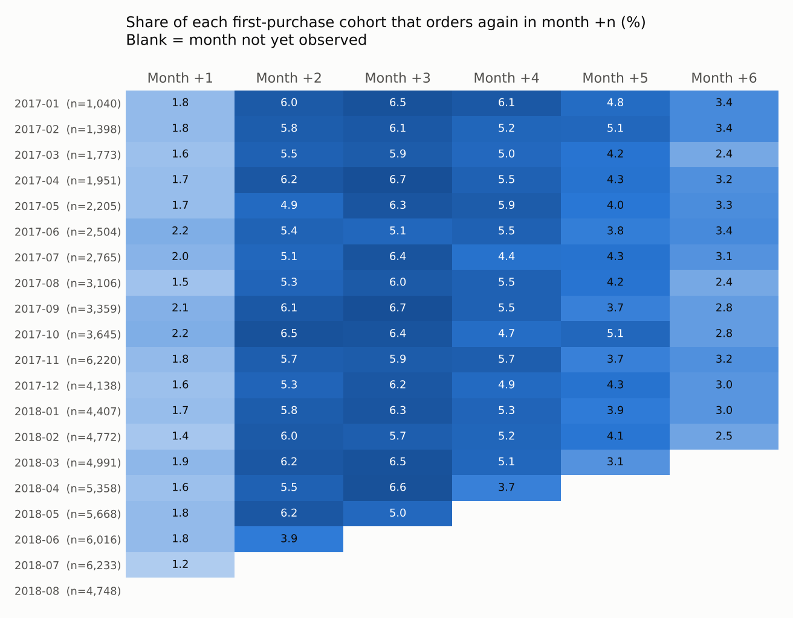
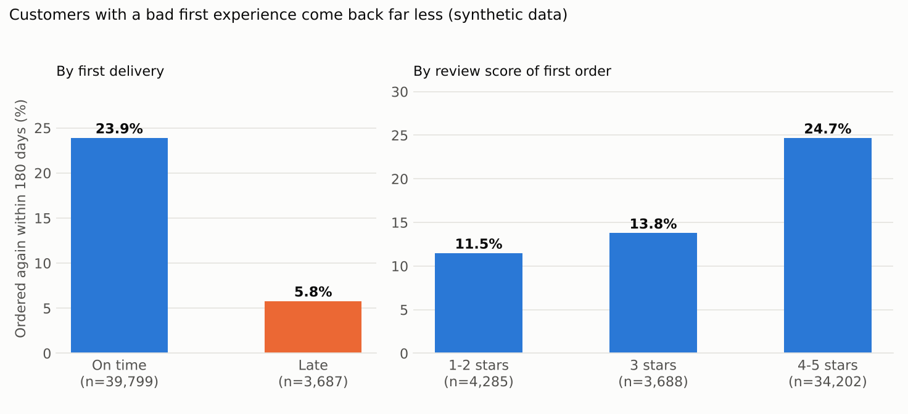
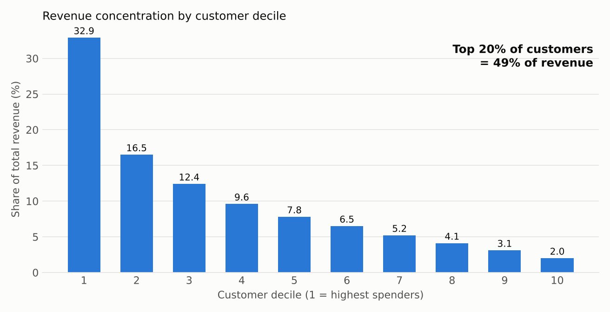
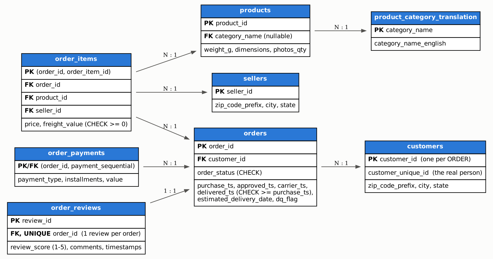

# E-commerce Customer Retention Analytics in PostgreSQL

An end-to-end SQL project: database design, data cleaning, 13 analytical queries, performance tuning and an
independent verification, all in plain PostgreSQL. One command rebuilds everything: `./run_all.sh`.

> ## Read this first: the data is synthetic
> Kaggle is not reachable from the environment this was built in, so the project runs on a **synthetic dataset shaped
> like the public Olist Brazilian-marketplace data** (same 8 tables, same column names, same quirks), generated by
> `00_data/generate_synthetic_olist.py` with a fixed seed.
>
> * It is **not real customer data**, and several behaviours (for example "late delivery lowers repeat purchase") are
>   **assumptions written into the generator**. The findings below demonstrate that the SQL *finds* such effects.
>   They are **not evidence about real customers**.
> * Describe it as "synthetic Olist-style dataset" on a resume or in an interview. To get real findings, run it on the
>   real Olist files (see [Using the real Olist data](#using-the-real-olist-data)).

## The business question

A marketplace wins a customer once but earns money when they come back. **Which customers are likely to stop buying,
how much revenue is at risk, and which retention action is worth paying for?**

## Results at a glance (synthetic data, ~98K orders, Jan 2017 to Aug 2018)

| Question | Answer from SQL | Query |
|---|---|---|
| How big is the business? | 93,250 delivered orders, R$ 18.4M revenue, 76,297 customers | `q01` |
| Do customers come back? | About 74.5% of customers with 180+ days of history never ordered a second time | `q05` |
| Does a bad first experience hurt? | Repeat rate within 180 days: **23.9% after an on-time first delivery vs 5.8% after a late one**; 24.7% after 4-5 star reviews vs 11.5% after 1-2 stars | `q06`, `q06b` |
| Who holds the revenue? | The top 20% of customers generate 49.4% of revenue | `q08` |
| Where is the win-back opportunity? | 11,688 "lapsed high-value" customers (15.3% of customers) hold 24.9% of revenue | `q03` |
| When should a win-back message go out? | Repeat buyers come back after a median of 94 days (IQR 66 to 133) | `q11` |
| Is a win-back voucher worth it? | Break-even reactivation rate is only 0.45% under the stated assumptions (all assumptions are placeholders, see `q12`) | `q12` |





## Schema



Design points worth knowing:

* `customers.customer_id` is **per order**; `customer_unique_id` is the real person. Every retention query groups by
  `customer_unique_id`. Grouping by `customer_id` would make every customer look like a one-time buyer.
* Constraints encode business rules: `delivered_ts >= purchase_ts`, non-negative prices, one review per order.
  The cleaning step exists so those constraints can be enforced.
* Secondary indexes are **deliberately not in the base schema**. They were added later, each justified by a measured query.

## Project layout

```
run_all.sh                 one command: database -> data -> schema -> cleaning -> analysis -> tuning -> charts -> verification
00_data/                   synthetic data generator (deterministic, seeded)
01_schema/                 staging (all text) -> load with \copy -> typed schema with PK/FK/CHECK
02_cleaning/               data-quality report, staging -> clean transform, post-load validation
03_analysis/               base views + q01..q12 (one statement per file)
04_optimization/           materialized view, functions, transaction demo, indexes, EXPLAIN ANALYZE benchmark
05_charts/                 charts built directly from the query files
tests/verify_with_pandas.py  recomputes key results from the raw CSVs with pandas and compares
results/                   real output of every step (query results, plans, benchmark table)
docs/                      ERD and charts
```

## SQL skills demonstrated and where to find them

| Skill | Where |
|---|---|
| Schema design, PK/FK/CHECK/UNIQUE, staging pattern | `01_schema/` |
| Data cleaning: `ROW_NUMBER()` dedupe, `NULLIF`, casts, text normalisation, audit flag column | `02_cleaning/02_transform.sql` |
| Data-quality report and post-load validation | `02_cleaning/01_dq_checks.sql`, `03_validation.sql` |
| CTEs, `DATE_TRUNC`, `LAG()`, running totals | `q01` |
| Cohort analysis, `age()`, pivot with `FILTER`, right-censoring guard | `q02` |
| `NTILE`, `CASE`, share-of-total windows (RFM) | `q03` |
| `DENSE_RANK() OVER (PARTITION BY ...)` | `q04` |
| `DISTINCT ON`, `NOT EXISTS` anti-join | `q05` |
| Cohort with a full observation window, EXISTS rewritten as a join | `q06`, `q06b` |
| `PERCENTILE_CONT`, `ROLLUP` | `q07` |
| Pareto / cumulative percentage with nested windows | `q08` |
| `generate_series` + `CROSS JOIN` + `LEFT JOIN` to expose gaps | `q09` |
| `CROSS JOIN LATERAL` top-N per group | `q10` |
| `ROW_NUMBER()` and `LAG()` on one window | `q11` |
| Parameter CTE, scenario table with `VALUES`, break-even maths | `q12` |
| Materialized view with concurrent refresh, SQL functions | `04_optimization/01`, `02` |
| Transactions, `ROLLBACK`, constraint failure handling | `04_optimization/03_transaction_demo.sql` |
| Indexing, partial index, `EXPLAIN (ANALYZE, BUFFERS)` | `04_optimization/04_indexes.sql`, `bench_explain.py` |

## Performance: what the benchmark actually showed

Median of 7 runs after a warm-up, PostgreSQL 16, ~98K orders, everything cached in memory
(`results/explain_before_after.md`, full plans in `results/plans/`):

| Query | Before | After | Verdict |
|---|---:|---:|---|
| Order history of one customer | 17.1 ms | 0.2 ms | Roughly 55 to 70x faster across two full runs. Seq scans replaced by index lookups. |
| Units and revenue for one product | 11.1 ms | 0.5 ms | Roughly 20 to 28x faster. Index on `order_items(product_id)`. |
| Daily revenue for one week | 23.5 ms | 29.4 ms | No gain. The partial index is used, but the cost is the join to `order_items`. |
| Q6 (late delivery vs repeat) | 678 ms | 884 ms | No gain. It must read almost every customer, so scans and hash joins are the right plan. |
| Q10 (top products per category) | 533 ms | 494 ms | No gain. It reads most of each category. |

The honest summary: indexes helped the **selective** lookups enormously and did nothing for queries that
**aggregate most of the table**. At this size (~100K rows) a parallel sequential scan is already cheap. The two
"no gain" analytical queries differ by roughly 10 to 30% between runs, so treat that as noise or slightly worse.
A second full run from a fresh unzip gave the same pattern with slightly different milliseconds; the table shows the first run.

## Lessons learned (real problems hit while building this)

1. **A correlated `NOT EXISTS` against a multi-join view never finished.** The first version of Q5 ran for more than
   5 minutes and was cancelled. `EXPLAIN` showed a `SubPlan` re-running the whole view once per customer. The kept
   copy is `04_optimization/slow_q05_correlated_view.sql`.
2. **`EXISTS` inside an aggregate `FILTER` can never become a join.** It stays a per-row subplan. Moving it into `WHERE`
   (Hash Anti Join) or rewriting it as a `LEFT JOIN` fixed it.
3. **A `MATERIALIZED` CTE hides table statistics.** The planner guessed 200 rows, then 1 row, and chose a nested loop
   that took minutes. Making the CTE `NOT MATERIALIZED` (inlined) brought Q6 to under a second.
4. **`NTILE()` over tied values is non-deterministic.** Recency is whole days, so thousands of customers tie. The RFM
   materialized view and the RFM query disagreed until each `NTILE` got a `customer_unique_id` tie-breaker. The
   independent pandas check caught this.

## Independent verification

`tests/verify_with_pandas.py` recomputes revenue, order and customer counts, the Pareto share, the Q6 cohort sizes
and repeat rates, and the RFM segment sizes from the raw CSVs with pandas, then compares them with PostgreSQL.
Latest run: **9 of 9 checks match** (`results/verification_pandas_vs_postgres.txt`).

## How to run

Requirements: PostgreSQL 13+ (tested on 16), `psql` on the PATH, Python 3 with `pandas`, `numpy` and `matplotlib`.
Graphviz is only needed to rebuild the ERD from `docs/erd.dot`.

```bash
# uses the standard PG* environment variables; needs a role that may create databases
export PGHOST=localhost PGUSER=postgres PGPASSWORD=...
./run_all.sh
# macOS/Windows: the database is created with LC_COLLATE C.UTF-8 and falls back to the server default if that locale
# does not exist; set DB_LOCALE=en_US.UTF-8 to choose another.
```

Runtime is roughly one minute. Every step writes its output to `results/`.

## Using the real Olist data

1. Download the Olist dataset from Kaggle and put the CSVs in `data/`, renamed to `customers.csv`, `orders.csv`,
   `order_items.csv`, `order_payments.csv`, `order_reviews.csv`, `products.csv`, `sellers.csv` and
   `product_category_name_translation.csv`. The geolocation file is not used.
2. Run `./run_all.sh`. It uses existing `data/*.csv` instead of generating data.
3. Expect to adapt the pipeline. I built the staging columns from the public Olist schema as I know it and could not
   test against the real files, so check the headers. Quirks I recall and have not verified here:
   * a few product categories may be missing from the translation table (this breaks the FK on `products`);
   * some `review_id` values may be reused across different orders (this breaks the PK on `order_reviews`).

   Fixing these is a good exercise, and the resulting findings would be real.

## Limitations

* Synthetic data, so no real-world conclusions. Repeat rates are far higher than in real Olist data.
* Q6 shows association, not causation. In real data late deliveries cluster in remote states.
* The Aug 2018 revenue drop in `q01` is mostly an artifact of orders still in transit at the data cut-off.
* `q12` assumptions (25% margin, R$10 voucher, R$0.40 contact cost, 2 to 8% reactivation) are placeholders, not data.
* The benchmark ran on one machine with a warm cache and a small dataset.

If you rerun it on the real Olist data, replace "synthetic" and add real findings.
